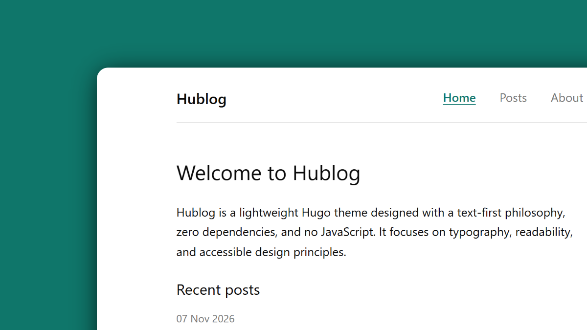

<p align="center">
  
  <h1 align="center">Hublog</h1>
</p>

<p align="center">A minimalist and lightweight Hugo blog theme. No dependencies, no JavaScript, and compatible with the standard Hugo binary.</p>

<p align="center">
  <a href="https://github.com/zkreations/hublog/blob/main/LICENSE"></a>
  <a href="https://github.com/zkreations/hublog/releases"></a>
  <a href="https://app.netlify.com/projects/hublog/deploys"></a>
</p>

<p align="center">
  <a href="#none"><strong>View a live demo →</strong></a>
</p>



## Features

- **Zero dependencies:** No Node.js, npm, Sass, or PostCSS required.
- **No JavaScript:** Pages are plain HTML and CSS.
- **Minimal design:** Focused on readable typography and content.
- **Automatic dark mode:** Uses `@media (prefers-color-scheme: dark)`.
- **Accessibility:** Semantic HTML5 landmarks, skip link, visible focus ring, and color contrast that meets WCAG AA ratios.
- **Hugo Standard:** Works with the standard Hugo binary (extended edition not required).
- **Metadata:** Open Graph, Twitter Cards, canonical URLs, and RSS autodiscovery.

## Requirements

- Hugo 0.164.0 or higher
- [Git](https://git-scm.com/downloads)

## Installation

### Option 1: As a Git submodule (Recommended)

From the root of your Hugo project:

```bash
git submodule add https://github.com/zkreations/hublog.git themes/hublog
```

Then add `theme = "hublog"` to your `hugo.toml`.

### Option 2: Direct clone

```bash
git clone https://github.com/zkreations/hublog.git themes/hublog
```

## Quick Start

The quickest way to get started is by copying the sample configuration from `exampleSite`:

```bash
cp themes/hublog/exampleSite/hugo.toml ./hugo.toml
```

To run the bundled demonstration site locally from the theme directory:

```bash
hugo server --source exampleSite --themesDir ../..
```

## Configuration Reference

Example `hugo.toml`:

```toml
baseURL = 'https://example.org/'
title = 'My Blog'
theme = 'hublog'
summaryLength = 25

[pagination]
  pagerSize = 5

[menus]
  [[menus.main]]
    name = 'Home'
    pageRef = '/'
    weight = 1

  [[menus.main]]
    name = 'Posts'
    pageRef = '/posts'
    weight = 2

  [[menus.main]]
    name = 'About'
    pageRef = '/about'
    weight = 3

[params]
  description = 'A personal blog about web development and minimalist design.'
  author = 'Author Name'
  date_format = '02 Jan 2006'
  home_posts_limit = 5
  show_reading_time = true
  footer_text = 'All rights reserved.'

  [[params.social]]
    name = 'GitHub'
    url = 'https://github.com/zkreations'
```

### Supported Parameters (`[params]`)

| Parameter | Type | Default | Description |
|---|---|---|---|
| `description` | string | `""` | Site description used for meta tags and homepage fallback. |
| `author` | string | `""` | Author name for metadata and structured data. |
| `date_format` | string | `"2006-01-02"` | Date display format (Go time format string). |
| `home_posts_limit` | int | `5` | Maximum number of recent posts listed on the homepage. |
| `show_reading_time` | bool | `true` | Display estimated reading time on articles. |
| `mainSections` | []string | `["posts"]` | Content sections treated as blog articles. |
| `footer_text` | string | `""` | Optional text displayed alongside the copyright in the footer. |
| `social` | []map | `[]` | List of social links with `name` and `url` displayed in the footer. |

### Post Front Matter

Posts support the following front matter variables:

```markdown
---
title: "Article Title"
date: 2026-11-08T10:00:00Z
description: "Brief summary used for previews and SEO meta description."
draft: false
tags: ["hugo", "minimalism"]
image: "/images/cover.jpg" # Optional featured image
---
```

## Customization

### CSS Tokens

All visual properties are defined as semantic CSS custom properties in `:root`. You can customize colors, fonts, and dimensions by overriding tokens in your site's `assets/css/main.css`:

```css
:root {
  --primary: #2563eb;
  --content-width: 70ch;
  --radius: 6px;
}

@media (prefers-color-scheme: dark) {
  :root {
    --primary: #93c5fd;
  }
}
```

### Overriding Templates

To override any template or partial, create a file with the same relative path inside your site's `layouts/` directory. For example, to customize the header, create `layouts/_partials/header.html`.

## License

This project is licensed under the [MIT](LICENSE) License. Created by [zkreations](https://www.zkreations.com).